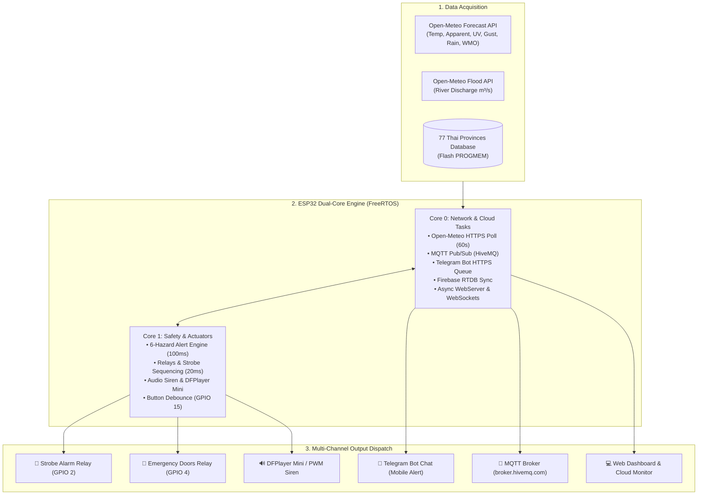

<div align="center">

# 🏢 Smart Building Command Center
### Real-time Multi-Hazard Disaster Early Warning & Life Safety IoT System (2026 Edition)

[](https://www.espressif.com/)
[](esp32-firmware/)
[](https://www.hivemq.com/)
[](https://core.telegram.org/bots)
[](web-dashboard/)
[](https://firebase.google.com/)
[](LICENSE)

*ระบบศูนย์เฝ้าระวัง ประเมินความเสี่ยง และแจ้งเตือนภัยพิบัติล่วงหน้าแบบเรียลไทม์ 6 มิติ (ครอบคลุม 77 จังหวัดทั่วไทย) พร้อมกลไกตอบสนองความปลอดภัยอัตโนมัติ (ปลดล็อกประตูฉุกเฉิน, ไฟไซเรน, และเสียงเตือนภัย)*

[ภาพรวมภาษาไทย](#-ภาพรวมโปรเจกต์-thai) • [English Overview](#-overview-english) • [ผังวงจรฮาร์ดแวร์ Pinout](#-ตารางเชื่อมต่อฮาร์ดแวร์-gpio-pinout) • [Quick Start](#-quick-start) • [พิมพ์เขียวระบบฉบับเต็ม (.md)](#-master-blueprint-for-ai--engineers)

---

</div>

## 🇹🇭 ภาพรวมโปรเจกต์ (Thai)

**Smart Building Command Center (2026 Edition)** คือระบบศูนย์ควบคุมและแจ้งเตือนภัยพิบัติอัจฉริยะสำหรับอาคาร ชุมชน และระบบโครงสร้างพื้นฐาน IoT โดยพัฒนาบนไมโครคอนโทรลเลอร์ **ESP32 Dual-Core (FreeRTOS SMP)** ทำการดึงข้อมูลสภาพอากาศดิบแบบ Field-to-Field จาก **Open-Meteo Weather Forecast & Flood API** ตามพิกัดดาวเทียมของ **77 จังหวัดทั่วประเทศไทย** 

ระบบทำการประเมินความเสี่ยงพร้อมกัน **6 มิติ (Multi-Hazard Alert Engine)** ตามเกณฑ์มาตรฐานสากลของ **WHO** และ **WMO**:
1. ☀️ **ดัชนีรังสียูวี (UV Index):** เฝ้าระวังเมื่อ $UV \ge 8.0$ (Very High) และเตือนภัยวิกฤตเมื่อ $UV \ge 11.0$ (Extreme)
2. 🌡️ **ดัชนีความร้อน / ความรู้สึกจริง (Apparent Temp / Heat Index):** เฝ้าระวังภาวะเพลียแดดเมื่อ $\ge 37.0$ °C และเตือนภัยฉุกเฉินโรคลมแดด (Heatstroke) เมื่อ $\ge 41.0$ °C
3. ⛈️ **พายุฝนฟ้าคะนอง (Thunderstorm):** จำแนกตามรหัส WMO Code (95: พายุฟ้าคะนอง, 96/99: พายุรุนแรงพร้อมลูกเห็บ)
4. 💨 **ลมกระโชกแรง (Wind Gusts):** เฝ้าระวังเมื่อ $\ge 50.0$ กม./ชม. และเตือนภัยพายุรุนแรงเมื่อ $\ge 89.0$ กม./ชม.
5. 🌧️ **ปริมาณน้ำฝน (Precipitation):** เฝ้าระวังเมื่อ $\ge 10.0$ มม./ชม. และเตือนภัยฝนตกหนักมากเสี่ยงน้ำท่วมฉับพลันเมื่อ $\ge 35.0$ มม./ชม.
6. 🌊 **ระดับน้ำในแม่น้ำ (River Discharge Flood):** เฝ้าระวังอัตราการไหลของน้ำในแม่น้ำเมื่อสูงกว่าเกณฑ์วิกฤต

### กลไกการตอบสนองความปลอดภัยและแจ้งเตือน (Output Dispatch):
* 🚨 **ไฟไซเรนฉุกเฉิน (Strobe Relay GPIO 2):** กะพริบเตือนเมื่อมีภัยระดับ WARNING หรือ CRITICAL
* 🚪 **ปลดล็อกประตูหนีไฟอัตโนมัติ (Emergency Door Relay GPIO 4):** ปลดล็อกอัตโนมัติเมื่อเกิดภัยระดับ CRITICAL
* 🔊 **เสียงเตือนภัยภาษาไทย / ไซเรน:** รองรับ **DFPlayer Mini (UART)** เล่นไฟล์เสียงประกาศภาษาไทย และมีระบบ **PWM Tone Siren (GPIO 27)** สังเคราะห์เสียงไซเรนฉุกเฉิน
* 📱 **Telegram Bot:** ส่งข้อความแจ้งเตือนภาษาไทยพร้อมระดับความรุนแรงและตำแหน่งเข้าแชตบนมือถือแบบเรียลไทม์
* 📡 **MQTT Protocol:** บรอดแคสต์สถานะ Strobe/Door/Telemetry ไปยัง **HiveMQ Broker** (`broker.hivemq.com:1883`)
* 💻 **Local & Cloud Dashboard:** มี Web Dashboard ฝังใน LittleFS ของ ESP32 สตรีมข้อมูลสดผ่าน WebSocket และซิงค์ขึ้น **Firebase Realtime Database**

---

## 📖 Overview (English)

The **Smart Building Command Center** is an industrial-grade, non-blocking disaster early-warning and automation node designed for facilities, campuses, and smart buildings. Built on **ESP32 Dual-Core (C++17 FreeRTOS)**, it ingests raw field-to-field meteorological data from **Open-Meteo Weather & Flood APIs** across all **77 provinces of Thailand**.

When severe conditions are detected, the system immediately triggers life-safety responses:
- Activates high-visibility **Strobe Alarm Relays**
- Executes automated **Emergency Door Lock Releases**
- Broadcasts real-time alert notifications via **Telegram Bot API**
- Publishes building automation commands via **MQTT (HiveMQ)**
- Serves an ultra-fast local responsive **WebSocket Dashboard** directly from LittleFS

---

## 🏗️ System Architecture (Data Pipeline)



---

## 🔌 ตารางเชื่อมต่อฮาร์ดแวร์ (GPIO Pinout)

| ขา ESP32 (GPIO) | ฟังก์ชันการทำงาน | อุปกรณ์ที่ต่อร่วม | แรงดันไฟ | คำอธิบาย |
| :---: | :--- | :--- | :---: | :--- |
| **GPIO 2** | เอาต์พุต Relay 1 (Strobe Alarm) | Relay Module 5V | 3.3V $\rightarrow$ 5V | สัญญาณไฟไซเรนฉุกเฉิน (Active HIGH / ขนานกับ LED บนบอร์ด) |
| **GPIO 4** | เอาต์พุต Relay 2 (Emergency Doors)| Relay Module ควบคุม Magnetic Lock | 3.3V $\rightarrow$ 5V | ปลดล็อกประตูหนีไฟอัตโนมัติเมื่อเกิดภัยระดับ CRITICAL |
| **GPIO 12** | เอาต์พุต LED เขียว (Normal) | LED 5mm + R 220Ω | 3.3V | ติดสว่างเมื่อสภาพอากาศปกติทุกมิติ |
| **GPIO 13** | เอาต์พุต LED เหลือง (Warning) | LED 5mm + R 220Ω | 3.3V | กะพริบช้าเมื่อมีภัยระดับเฝ้าระวัง (WARNING) |
| **GPIO 14** | เอาต์พุต LED แดง (Critical) | LED 5mm + R 220Ω | 3.3V | กะพริบถี่เมื่อเกิดภัยระดับวิกฤต (CRITICAL) |
| **GPIO 15** | อินพุตสวิตช์ปุ่มกด (Silence/Test)| Tactile Switch เข้า GND | 3.3V | `INPUT_PULLUP` กดสั้น = ปิดเสียง, กดยาว = ทดสอบระบบ |
| **GPIO 16 (RX2)** | รับสัญญาณ UART จาก DFPlayer | DFPlayer Mini ขา TX | 3.3V | ต่อผ่านตัวต้านทาน 1kΩ |
| **GPIO 17 (TX2)** | ส่งคำสั่ง UART สู่ DFPlayer | DFPlayer Mini ขา RX | 3.3V | ต่อผ่านตัวต้านทาน 1kΩ (ป้องกันเสียงฮัม) |
| **GPIO 27** | เอาต์พุตเสียงไซเรน (PWM Tone) | Piezo Buzzer / ลำโพง | 3.3V | สังเคราะห์เสียงไซเรนความถี่กวาด (Sweep 800-2400 Hz) |
| **GPIO 34** | อนาล็อกเซนเซอร์วัดแสงในอาคาร | โมดูลวัดแสง LDR | 0 - 3.3V | **ADC1 Pin** (ปลอดภัย ใช้งานร่วมกับ Wi-Fi ได้) |
| **GPIO 35** | โพเทนชิโอมิเตอร์ปรับจูนเกณฑ์ | 10k Potentiometer | 0 - 3.3V | **ADC1 Pin** ปรับจูนความไวในพื้นที่ |

---

## 🚀 Quick Start

### 1. ตั้งค่ารหัสผ่านและ Credentials
```bash
copy secrets.example.env secrets.env
```
เปิดไฟล์ `secrets.env` แล้วกรอกชื่อ Wi-Fi, Telegram Bot Token, และ Chat ID ของคุณ จากนั้นรัน:
```bash
py setup_secrets.py
```

### 2. ทดสอบระบบด้วยตัวจำลองภัยพิบัติ (Disaster Simulator)
สามารถทดสอบการประเมินภัย 6 มิติ และการส่งข้อความเข้า Telegram Bot ได้ทันทีโดยไม่ต้องต่อฮาร์ดแวร์:
```bash
py simulate_esp32.py
```
*(หรือรันแบบดึงสภาพอากาศจริง: `py simulate_esp32.py --live`)*

### 3. ควบคุมและคอมไพล์ผ่านเมนู 1-Click (`menu.bat`)
รันไฟล์ `menu.bat` บน Windows เพื่อเข้าสู่หน้าต่างสั่งการครบวงจร:
- **[1]** เปิด Web Dashboard (Dev Mode)
- **[4]** คอมไพล์เฟิร์มแวร์ ESP32
- **[5]** อัปโหลดเฟิร์มแวร์ลงบอร์ด ESP32
- **[6]** อัปโหลดหน้าเว็บลงหน่วยความจำ LittleFS ของ ESP32
- **[8]** เปิดตัวจำลองภัยพิบัติ 6 มิติ
- **[9]** เปิด Telegram Bot Notification Service

---

## 📚 Master Blueprint for AI & Engineers

สำหรับ AI Agent หรือวิศวกรที่ต้องการดูรายละเอียดเชิงลึกทั้งหมด เช่น:
- รายละเอียดสมการการคำนวณและ Hysteresis Debounce
- ตารางพิกัด ละติจูด/ลองจิจูด ของ 77 จังหวัดทั่วไทย
- ผังหน่วยความจำ FreeRTOS Task Matrix และ Mutex Semaphore
- โครงสร้าง JSON Schema ของ Telegram, MQTT, และ Firebase

👉 **กรุณาอ่านไฟล์:** [`docs/SMART_BUILDING_COMMAND_CENTER_2026.md`](docs/SMART_BUILDING_COMMAND_CENTER_2026.md) และคู่มือต่อวงจร [`docs/CIRCUIT_WIRING_GUIDE.md`](docs/CIRCUIT_WIRING_GUIDE.md)

---

## 📂 โครงสร้างโปรเจกต์ (Project Structure)

```text
ESP32-Firebase-007-main/
├── .github/              # Issue & PR Templates
├── docs/                 # คู่มือวงจร, พิมพ์เขียวระบบ, และ Architecture
│   ├── CIRCUIT_WIRING_GUIDE.md
│   ├── SMART_BUILDING_COMMAND_CENTER_2026.md
│   └── architecture.md
├── esp32-firmware/       # เฟิร์มแวร์ C++17 FreeRTOS บนบอร์ด ESP32
├── web-dashboard/        # เว็บแดชบอร์ด PWA (Vite 8.2 + TS + Tailwind + Workbox)
├── mcp-server/           # AI Model Context Protocol (MCP) Server สำหรับ Agent
├── simulator/            # ชุดจำลองเซนเซอร์และภัยพิบัติ 6 มิติ (simulate_esp32.py)
├── telegram-bot/         # ระบบส่งข้อความแจ้งเตือนภัยผ่าน Telegram Bot
├── discord-bot/          # ระบบแจ้งเตือนและสังเกตการณ์ผ่าน Discord Bot
├── scripts/              # สคริปต์ยูทิลิตี้ (setup_secrets, check_db, run_live_web)
├── menu.bat              # เมนูคำสั่งลัด All-in-One CLI สำหรับ Windows
├── database.rules.json   # กฎความปลอดภัย Firebase Realtime Database
├── vercel.json           # การตั้งค่า Deployment บน Vercel
└── .mcp.json             # คอนฟิก MCP Tool Server สำหรับผู้ช่วย AI
```

---

## 📄 License
This project is licensed under the MIT License - see the [LICENSE](LICENSE) file for details.
