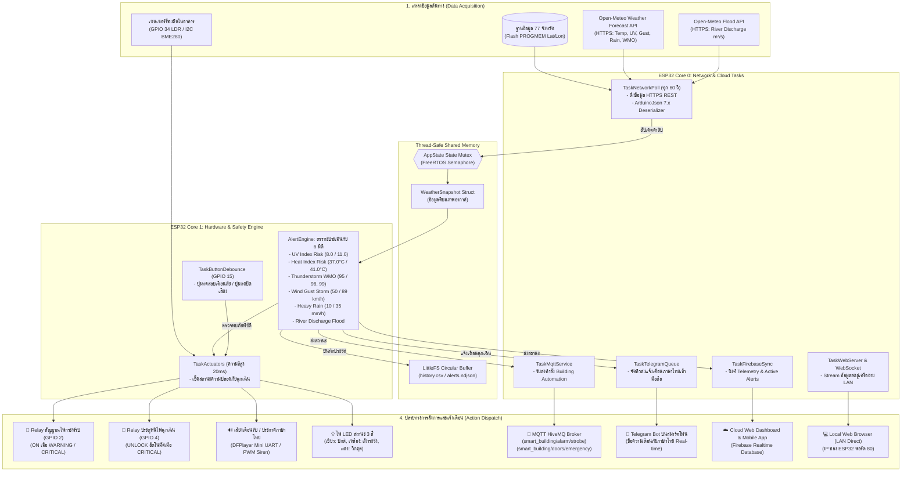

# 🏢 SMART BUILDING COMMAND CENTER (2026 EDITION)
## ระบบศูนย์ควบคุมและแจ้งเตือนภัยพิบัติอัจฉริยะแบบเรียลไทม์ 6 มิติบน ESP32 Dual-Core
### Enterprise-Grade Disaster Early Warning & Automation Microcontroller System

> **สำหรับ AI Agent, System Engineers, และ Embedded Developers**: 
> เอกสารฉบับนี้คือ **Master Architectural Blueprint (พิมพ์เขียวระบบสมบูรณ์)** รวบรวมสถาปัตยกรรมทุกมิติ การไหลของข้อมูล (Data Pipeline: จากไหน ไปไหน), ตรรกะการประเมินภัยพิบัติ 6 มิติตามมาตรฐาน WHO/WMO, โครงสร้าง FreeRTOS Task Matrix บน ESP32 Dual-Core, แผนผังวงจรขา GPIO (Pinout & Wiring), ฐานข้อมูลพิกัด 77 จังหวัดทั่วไทย, โปรโตคอลการสื่อสาร (MQTT, Telegram Bot, Firebase RTDB, Async WebSockets) และ Tech Stack มาตรฐานปี 2026 ทั้งหมด

---

## 📑 สารบัญ (Table of Contents)
1. [เป้าหมายและภาพรวมโครงการ (Executive Summary)](#1-เป้าหมายและภาพรวมโครงการ)
2. [Tech Stack & Architecture มาตรฐานปี 2026](#2-tech-stack--architecture-มาตรฐานปี-2026)
3. [สถาปัตยกรรมการไหลของข้อมูล (Data Pipeline: จากไหน ไปไหน)](#3-สถาปัตยกรรมการไหลของข้อมูล)
4. [ตรรกะการประเมินความเสี่ยง 6 มิติ (Multi-Hazard Alert Engine)](#4-ตรรกะการประเมินความเสี่ยง-6-มิติ)
5. [ผังวงจรและตารางเชื่อมต่อฮาร์ดแวร์ (GPIO Pinout & Schematics)](#5-ผังวงจรและตารางเชื่อมต่อฮาร์ดแวร์)
6. [สถาปัตยกรรมระบบสมองกล FreeRTOS Dual-Core (Task Matrix)](#6-สถาปัตยกรรมระบบสมองกล-freertos-dual-core)
7. [ฐานข้อมูลพิกัด 77 จังหวัดทั่วไทย (Geolocation Database)](#7-ฐานข้อมูลพิกัด-77-จังหวัดทั่วไทย)
8. [โปรโตคอลและการส่งข้อมูลปลายทาง (Output Services)](#8-โปรโตคอลและการส่งข้อมูลปลายทาง)
   - 8.1 MQTT Protocol (HiveMQ IoT Automation)
   - 8.2 Telegram Bot API (Mobile Urgent Dispatch)
   - 8.3 Digital Audio & Voice Alert (DFPlayer Mini / PWM Siren)
   - 8.4 Local Web Dashboard & Async WebSocket API
   - 8.5 Cloud Synchronization (Firebase Realtime Database)
9. [โครงสร้างไฟล์และโมดูลในโปรเจกต์ (Project Directory Structure)](#9-โครงสร้างไฟล์และโมดูลในโปรเจกต์)
10. [คู่มือการติดตั้ง ใช้งาน และทดสอบ (Deployment & Runbook)](#10-คู่มือการติดตั้ง-ใช้งาน-และทดสอบ)

---

## 1. เป้าหมายและภาพรวมโครงการ

ระบบ **Smart Building Command Center** คือระบบศูนย์เฝ้าระวัง ประเมินความเสี่ยง และแจ้งเตือนภัยพิบัติล่วงหน้าแบบเรียลไทม์ตามพิกัดพื้นที่ (รองรับทั้ง 77 จังหวัดทั่วประเทศไทย) ออกแบบมาเพื่อติดตั้งในอาคารสำนักงาน โรงเรียน โรงงาน คลังสินค้า ชุมชน หรือโครงสร้างพื้นฐาน IoT 

### วัตถุประสงค์หลัก:
1. **ป้องกันอันตรายต่อชีวิตและทรัพย์สิน**: เฝ้าระวังสภาพอากาศสุดขั้ว (Extreme Weather Events) ทั้งดัชนีรังสียูวีสูงจัด, คลื่นความร้อนเสี่ยงโรคลมแดด (Heatstroke), พายุฟ้าคะนองรุนแรงพร้อมลูกเห็บ, ลมพายุพัดกระโชก, ฝนตกหนักเสี่ยงน้ำท่วมฉับพลัน และปริมาณน้ำในแม่น้ำสายหลัก
2. **ระบบตอบสนองอัตโนมัติ (Automated Life Safety Actions)**: เมื่อตรวจพบภัยพิบัติระดับวิกฤต (CRITICAL) บอร์ด ESP32 จะสั่งการรีเลย์ปลดล็อกประตูหนีไฟฉุกเฉิน (Emergency Door Release) ทันที พร้อมเปิดสัญญาณไฟไซเรน (Strobe Alarm Relay) และส่งเสียงเตือนภัย
3. **การสื่อสารแบบ Real-Time Multi-Channel**: กระจายข้อมูลพร้อมกันไปยัง Telegram Bot บนสมาร์ตโฟน, บรอดแคสต์ผ่านโบรเกอร์ MQTT สู่ระบบอาคาร, ซิงค์ขึ้นคลาวด์ Firebase และให้บริการหน้าเว็บบน Local Wi-Fi ของ ESP32 แบบไม่ต้องพึ่งอินเทอร์เน็ตภายนอกตลอดเวลา

---

## 2. Tech Stack & Architecture มาตรฐานปี 2026

โปรเจกต์นี้เลือกใช้เทคโนโลยีทันสมัย เสถียรสูง และปลอดภัยระดับ Enterprise ตามมาตรฐาน IoT ปี 2026:

| Layer | เทคโนโลยี / เฟรมเวิร์ก | เวอร์ชัน/มาตรฐาน | เหตุผลและความเหมาะสม (Rationale) |
| :--- | :--- | :---: | :--- |
| **Microcontroller Hardware** | **Espressif ESP32** (Dual-Core Xtensa LX6) | 240 MHz, 520KB SRAM, 4MB Flash | ฮาร์ดแวร์ยอดนิยม มี Wi-Fi/BLE ในตัว ราคาเข้าถึงง่าย รองรับระบบมัลติทาสก์ระดับอุตสาหกรรม |
| **Firmware Core** | **ESP-IDF v5.x / Arduino-ESP32 Core** | **v3.x+ (C++17/C++20)** | รองรับ Modern C++ (Structured Binding, `std::string_view`, `constexpr`), Memory-safe, Zero-leakage |
| **RTOS Kernel** | **FreeRTOS (Symmetric Multiprocessing)** | SMP FreeRTOS Core 0 & Core 1 | แยกภาระงานเน็ตเวิร์ก/คลาวด์ (Core 0) ออกจากงานควบคุมฮาร์ดแวร์/รีเลย์/เซนเซอร์ (Core 1) เด็ดขาด ป้องกันการกระตุก (Non-blocking) |
| **JSON Serialization** | **ArduinoJson** | **v7.x+** | ใช้ Memory Pool อัตโนมัติ ป้องกัน Stack Overflow จาก Dynamic Allocation เดิมใน v6 |
| **Network Client** | **WiFiClientSecure (TLS 1.3) + HTTPClient** | BearSSL / mbedTLS | เชื่อมต่อ HTTPS REST API ของ Open-Meteo และ Telegram Bot อย่างปลอดภัย |
| **IoT Protocol** | **MQTT (PubSubClient / HiveMQ)** | MQTT v3.1.1 / QoS 1 | ส่งสัญญาณเตือนไปยังระบบ Building Automation สากล รวดเร็ว และประหยัด Bandwidth |
| **Voice / Sound** | **DFPlayer Mini (UART) + PWM Tone Siren** | Hardware Serial2 (16/17) + ESP32 LEDC PWM | รองรับไฟล์เสียงภาษาไทยคมชัดจาก MicroSD Card พร้อมระบบเสียงไซเรนสำรองผ่านลำโพง/บัซเซอร์ |
| **On-board Storage** | **LittleFS** | Flash Filesystem | ทนทานต่อการดับของไฟ (Power-cut resilient) ใช้บันทึก Log เหตุการณ์แบบ NDJSON/CSV และเก็บหน้าเว็บออฟไลน์ |
| **Cloud Database** | **Firebase Realtime Database (RTDB)** | REST API with Token-based Auth | ความหน่วงต่ำ (<200ms) ซิงค์ข้อมูลสภาพอากาศและสถานะเตือนภัยขึ้นคลาวด์แบบ Realtime |
| **Local Web Interface** | **ESPAsyncWebServer + AsyncTCP** | v3.6.x | เสิร์ฟหน้าเว็บความเร็วสูงระดับ Non-blocking พร้อม WebSocket Broadcast ข้อมูลสดทุกวินาที |
| **Web Dashboard** | **Vite + TypeScript + Tailwind CSS** | Vite v8.x, TS v7.x | หน้าเว็บ Dark UI หรูหราทันสมัย โหลดเร็วระดับ sub-100ms รองรับมือถือและคอมพิวเตอร์ |
| **Simulation & Bot** | **Python Asyncio + Telegram Bot API** | Python 3.12+ | ซิมูเลเตอร์จำลองสภาพอากาศสุดขั้วทั้ง 6 มิติ และบอทบริการแจ้งเตือน |

---

## 3. สถาปัตยกรรมการไหลของข้อมูล (Data Pipeline: จากไหน ไปไหน)



---

## 4. ตรรกะการประเมินความเสี่ยง 6 มิติ (Multi-Hazard Alert Engine)

ระบบประเมินค่าดิบ (Field-to-Field) ที่ดึงมาจาก Open-Meteo เทียบกับเกณฑ์มาตรฐานความปลอดภัยสากลของ **องค์การอนามัยโลก (WHO)** และ **องค์การอุตุนิยมวิทยาโลก (WMO)**:

| มิติที่ | ประเภทภัย (Hazard Kind) | ฟิลด์ข้อมูลดิบที่วัด | เกณฑ์เฝ้าระวัง (WARNING) | เกณฑ์เตือนภัยวิกฤต (CRITICAL) | ผลกระทบและการตอบสนองของระบบ |
| :---: | :--- | :--- | :--- | :--- | :--- |
| **1** | **ดัชนีรังสียูวี (UV Index)** | `uv_index` | $\ge 8.0$ (Very High) | $\ge 11.0$ (Extreme) | **WARNING**: แจ้งเตือนหลีกเลี่ยงแดดจัด<br>**CRITICAL**: ไฟเตือนทำงาน, ประกาศเตือนเสี่ยงผิวไหม้รุนแรงในไม่กี่นาที |
| **2** | **ความรู้สึกร้อน (Heat Index / Apparent Temp)** | `apparent_temperature` | $\ge 37.0$ °C (ภาวะเพลียแดด) | $\ge 41.0$ °C (อันตรายมาก - เสี่ยงโรคลมแดด) | **WARNING**: เตือนดื่มน้ำ พักในที่ร่ม<br>**CRITICAL**: สัญญาณเตือน Heatstroke, ปรับโหมดระบายอากาศอาคาร |
| **3** | **พายุฝนฟ้าคะนอง (Thunderstorm)** | `weather_code` (WMO) | Code `95` (ฝนฟ้าคะนอง) | Code `96`, `99` (พายุรุนแรงพร้อมลูกเห็บ) | **WARNING**: ระวังฟ้าผ่าและลมกระโชก<br>**CRITICAL**: ไฟไซเรนติด, ปลดล็อกประตูฉุกเฉิน, สั่งเก็บป้าย/อุปกรณ์ภายนอก |
| **4** | **ลมกระโชกแรง (Wind Gusts)** | `wind_gusts_10m` | $\ge 50.0$ km/h | $\ge 89.0$ km/h (พายุลมกระโชกรุนแรง) | **WARNING**: เฝ้าระวังสิ่งของปลิว<br>**CRITICAL**: เตือนภัยพายุโครงสร้างอาคาร สั่งอพยพพื้นที่โล่ง |
| **5** | **ฝนตกหนัก (Precipitation)** | `precipitation` | $\ge 10.0$ mm/h | $\ge 35.0$ mm/h (ฝนตกหนักมาก) | **WARNING**: ระวังน้ำท่วมขังทางเดิน<br>**CRITICAL**: เตือนเสี่ยงน้ำท่วมฉับพลัน/ดินถล่ม เตรียมเปิดเครื่องสูบน้ำ |
| **6** | **ระดับน้ำในแม่น้ำ (River Discharge)** | `river_discharge` | $\ge 500.0$ m³/s *(หรือตาม Config)* | $\ge 800.0$ m³/s | **WARNING/CRITICAL**: แจ้งเตือนชุมชนริมน้ำและชั้นใต้ดินอาคาร |

### ตารางรหัสสภาพอากาศ WMO Weather Interpretation Codes (WMO Code):
* **0**: ท้องฟ้าแจ่มใส (Clear Sky)
* **1, 2, 3**: ท้องฟ้าโปร่ง / เมฆบางส่วน / มีเมฆมาก (Mainly clear, partly cloudy, overcast)
* **45, 48**: หมอกหนา / หมอกน้ำค้างแข็ง (Fog)
* **51, 53, 55**: ฝนละอองเบา / ปานกลาง / หนาแน่น (Drizzle)
* **61, 63, 65**: ฝนตกเล็กน้อย / ปานกลาง / ฝนตกหนัก (Rain)
* **80, 81, 82**: ฝนซู่ตกกระจาย (Rain showers)
* **95**: ฝนฟ้าคะนอง (Thunderstorm) $\rightarrow$ **WARNING**
* **96, 99**: พายุฝนฟ้าคะนองรุนแรงพร้อมลูกเห็บ (Thunderstorm with hail) $\rightarrow$ **CRITICAL**

---

## 5. ผังวงจรและตารางเชื่อมต่อฮาร์ดแวร์ (GPIO Pinout & Schematics)

ผังการต่อขาสำหรับบอร์ด **ESP32 DevKit V1 (30 หรือ 38 ขา)**:

```
                          ┌──────────────────────────┐
                          │     ESP32 DEVKIT V1      │
                          │                          │
        (Onboard LED Sync)│GPIO 2   [RELAY 1: STROBE]│===> ไฟกระพริบฉุกเฉิน (Strobe Alarm)
(Emergency Door Release)  │GPIO 4   [RELAY 2: DOORS] │===> คอยล์แม่เหล็กปลดล็อกประตูหนีไฟ
      (Normal Status Green)│GPIO 12  [LED: NORMAL]    │===> LED เขียว (สถานะปกติ)
     (Warning Status Yellow)│GPIO 13  [LED: WARNING]   │===> LED เหลือง (เฝ้าระวัง)
     (Critical Status Red)│GPIO 14  [LED: CRITICAL]  │===> LED แดง (เตือนภัยวิกฤต)
   (Silence / Test Button)│GPIO 15  [PUSH BUTTON]    │===> สวิตช์ปุ่มกด (Active LOW + Pull-up)
     (DFPlayer Mini UART) │GPIO 16  [UART2 RX2]      │<=== DFPlayer TX Pin (ผ่านตัวต้านทาน 1kΩ)
     (DFPlayer Mini UART) │GPIO 17  [UART2 TX2]      │===> DFPlayer RX Pin (ผ่านตัวต้านทาน 1kΩ)
    (Emergency PWM Siren) │GPIO 27  [BUZZER / SIREN] │===> ลำโพงไซเรน / Piezo Buzzer (LEDC PWM)
 (Indoor Ambient Sensor)  │GPIO 34  [ADC1: LDR LIGHT]│<=== LDR แบ่งแรงดัน (ตรวจแสงสว่างในอาคาร)
 (Local Sensitivity Dial) │GPIO 35  [ADC1: POT DIAL] │<=== โพเทนชิโอมิเตอร์ (ปรับความไวเกณฑ์เตือน)
                          │GND                       │===> กราวด์ร่วม (Common Ground)
                          │5V (VIN)                  │<=== แหล่งจ่ายไฟกระแสตรง 5V 2A-3A
                          └──────────────────────────┘
```

### ตารางระบุขาสัญญาณและฟังก์ชันฮาร์ดแวร์:

| ขา ESP32 (GPIO) | ฟังก์ชันการทำงาน | อุปกรณ์ที่ต่อร่วม | แรงดันไฟ | ข้อควรระวังและคำแนะนำทางวิศวกรรม |
| :---: | :--- | :--- | :---: | :--- |
| **GPIO 2** | เอาต์พุต Relay 1 (Strobe Alarm) | Relay Module 5V / Optocoupler | 3.3V $\rightarrow$ 5V | ทำงานแบบ Active HIGH ขนานกับไฟ LED บนบอร์ด ESP32 เพื่อสังเกตการณ์ |
| **GPIO 4** | เอาต์พุต Relay 2 (Emergency Doors) | Relay Module ควบคุม Magnetic Lock | 3.3V $\rightarrow$ 5V | สั่งปลดล็อกประตูเมื่อเกิดภัยระดับ CRITICAL (Fail-Safe Mechanism) |
| **GPIO 12** | เอาต์พุต LED สีเขียว (Normal) | LED 5mm + R 220Ω | 3.3V | สว่างค้างเมื่อสภาพอากาศปกติทุกมิติ |
| **GPIO 13** | เอาต์พุต LED สีเหลือง (Warning) | LED 5mm + R 220Ω | 3.3V | กะพริบช้าเมื่อมีภัยระดับเฝ้าระวัง (WARNING) |
| **GPIO 14** | เอาต์พุต LED สีแดง (Critical) | LED 5mm + R 220Ω | 3.3V | กะพริบเร็วถี่เมื่อมีภัยระดับวิกฤต (CRITICAL) |
| **GPIO 15** | อินพุต Push Button (Silence/Test) | Tactile Switch เข้า GND | 3.3V | เปิดใช้งาน `INPUT_PULLUP` ภายใน กดสั้น = ปิดเสียงชั่วคราว, กดยาว = ทดสอบระบบ |
| **GPIO 16 (RX2)** | รับสัญญาณ UART จาก DFPlayer | DFPlayer Mini ขา TX | 3.3V | ต่อตรงหรือผ่าน R 1kΩ เพื่อลดสัญญาณรบกวน |
| **GPIO 17 (TX2)** | ส่งคำสั่ง UART สู่ DFPlayer | DFPlayer Mini ขา RX | 3.3V | **ต้องต่อตัวต้านทาน 1kΩ คั่น** ป้องกันเสียงรบกวนและระดับแรงดัน |
| **GPIO 27** | สัญญาณเสียงไซเรน (PWM Tone) | Active/Passive Buzzer หรือ Amp | 3.3V | ควบคุมความถี่เสียงแบบ Sweep Frequency (800Hz - 2500Hz) ผ่าน FreeRTOS |
| **GPIO 34** | อนาล็อกเซนเซอร์วัดแสงในอาคาร | โมดูลวัดแสง LDR | 0 - 3.3V | **อยู่บนบล็อก ADC1** (สามารถอ่านค่าได้แม้ขณะ Wi-Fi กำลังรับส่งข้อมูล) |
| **GPIO 35** | โพเทนชิโอมิเตอร์ปรับเกณฑ์ | 10k Potentiometer | 0 - 3.3V | **อยู่บนบล็อก ADC1** ใช้ปรับจูน Offset ความไวในการประเมินความเสี่ยง |

---

## 6. สถาปัตยกรรมระบบสมองกล FreeRTOS Dual-Core (Task Matrix)

เพื่อป้องกันการหยุดชะงักของระบบความปลอดภัยขณะเชื่อมต่ออินเทอร์เน็ต (Zero-blocking Architecture) ระบบแบ่งการทำงานออกเป็น **2 คอร์ (Dual-Core SMP)** อย่างอิสระ:

```
┌────────────────────────────────────────────────────────┐
│                   ESP32 DUAL-CORE CPU                  │
├────────────────────────────┬───────────────────────────┤
│    CORE 0 (COMMUNICATION)  │   CORE 1 (REAL-TIME IO)   │
├────────────────────────────┼───────────────────────────┤
│ • TaskNetworkPoll (60s)    │ • TaskHazardEngine (100ms)│
│ • TaskMqttService (Event)  │ • TaskActuators (20ms)    │
│ • TaskTelegramQueue (Async)│ • TaskButtonInput (10ms)  │
│ • TaskFirebaseSync (5s)    │ • TaskAudioSiren (LEDC)   │
│ • TaskWebServer (Port 80)  │ • TaskLocalSensors (500ms)│
└────────────────────────────┴───────────────────────────┘
```

### ตาราง FreeRTOS Task Matrix:

| ชื่อ Task | คอร์ CPU | ความสำคัญ (Priority) | Stack Size | รอบการทำงาน (Interval) | หน้าที่และความรับผิดชอบ |
| :--- | :---: | :---: | :---: | :---: | :--- |
| **`TaskHazardEngine`** | Core 1 | 4 (สูงมาก) | 4096 bytes | 100 ms | รับค่า Snapshot ล่าสุด คำนวณความเสี่ยง 6 มิติ เทียบ Hysteresis และสั่ง Action ทันที |
| **`TaskActuators`** | Core 1 | 3 (สูง) | 3072 bytes | 20 ms | สั่งเปิด-ปิดรีเลย์, กะพริบไฟ Strobe, ควบคุมไฟ LED 3 สี และขับเสียงเตือนภัย |
| **`TaskButtonInput`** | Core 1 | 3 (สูง) | 2048 bytes | 10 ms | ตรวจจับการกดปุ่มแบบไม่กระตุก (Software Debounce) แยกแยะกดสั้น/กดยาว |
| **`TaskNetworkPoll`** | Core 0 | 2 (ปานกลาง) | 8192 bytes | 60 วินาที | ดึงข้อมูลสภาพอากาศดิบและระดับน้ำจาก Open-Meteo REST API ผ่าน HTTPS |
| **`TaskTelegramQueue`** | Core 0 | 1 (ต่ำ) | 6144 bytes | Event-Driven | ส่งข้อความเตือนภัยภาษาไทยพร้อมไอคอน 🚨 เข้าห้องแชต มีระบบป้องกันการส่งซ้ำ |
| **`TaskMqttService`** | Core 0 | 2 (ปานกลาง) | 4096 bytes | Event / 100ms | บรอดแคสต์สถานะ Strobe/Door/Telemetry ไปยัง HiveMQ และรับคำสั่งรีโมต |
| **`TaskFirebaseSync`** | Core 0 | 1 (ต่ำ) | 8192 bytes | 5 - 10 วินาที | อัปเดตข้อมูลสภาพอากาศสดและรายการ Alert ขึ้น Firebase Realtime Database |
| **`TaskWebServer`** | Core 0 | 2 (ปานกลาง) | 4096 bytes | Async Event | ให้บริการ REST API และสตรีม WebSocket สู่เบราว์เซอร์ภายในวง LAN |

---

## 7. ฐานข้อมูลพิกัด 77 จังหวัดทั่วไทย (Geolocation Database)

ระบบบรรจุตารางพิกัดภูมิศาสตร์ของ 77 จังหวัดทั่วประเทศไทยไว้ใน Flash Memory (`PROGMEM`) ของ ESP32 โดยตรง ช่วยให้ผู้ใช้สามารถสลับการเฝ้าระวังไปยังจังหวัดใดก็ได้แบบเรียลไทม์โดยไม่ต้องต่ออินเทอร์เน็ตเพื่อค้นหาพิกัด:

### พิกัดตัวอย่างสำหรับทดสอบ:
* **กรุงเทพมหานคร**: ละติจูด `13.7563`, ลองจิจูด `100.5018`
* **เชียงใหม่**: ละติจูด `18.7883`, ลองจิจูด `98.9853`
* **ภูเก็ต**: ละติจูด `7.8804`, ลองจิจูด `98.3923`
* **ขอนแก่น**: ละติจูด `16.4419`, ลองจิจูด `102.8359`
* **ชลบุรี**: ละติจูด `13.3611`, ลองจิจูด `100.9847`
* **อุบลราชธานี**: ละติจูด `15.2448`, ลองจิจูด `104.8473`
*(ตารางรหัส C++ ครบถ้วนทั้ง 77 จังหวัดถูกสร้างไว้ในไฟล์ `provinces.h`)*

---

## 8. โปรโตคอลและการส่งข้อมูลปลายทาง (Output Services)

### 8.1 MQTT Protocol (HiveMQ IoT Automation)
* **Broker Host**: `broker.hivemq.com` (พอร์ต `1883`)
* **Topic ควบคุมไฟไซเรน**: `smart_building/alarm/strobe`
  * Payload: `"ON"` (เมื่อสถานะเป็น WARNING หรือ CRITICAL), `"OFF"` (เมื่อสถานะปกติ)
* **Topic ควบคุมประตูฉุกเฉิน**: `smart_building/doors/emergency`
  * Payload: `"UNLOCK"` (เมื่อเกิดภัย CRITICAL), `"LOCKED"` (เมื่อปกติ)
* **Topic ข้อมูลสภาพอากาศดิบ**: `smart_building/telemetry/weather`
  * Payload: JSON บรรจุค่าอุณหภูมิ, UV, ฝน, ลม, รหัส WMO, และความเสี่ยง
* **Topic คำสั่งรีโมต (Subscribe)**: `smart_building/command/#`
  * `smart_building/command/province`: สั่งเปลี่ยนจังหวัด (เช่น `"เชียงใหม่"`)
  * `smart_building/command/test`: สั่งทดสอบระบบเตือนภัยฉุกเฉิน
  * `smart_building/command/silence`: สั่งปิดเสียงเตือนภัย

### 8.2 Telegram Bot API (Mobile Urgent Dispatch)
ส่งข้อความแจ้งเตือนผ่าน HTTPS POST ไปยัง Telegram Bot API ทันทีที่ตรวจพบระดับความเสี่ยง:
* **URL**: `https://api.telegram.org/bot<TELEGRAM_BOT_TOKEN>/sendMessage`
* **รูปแบบข้อความ (Markdown Format)**:
```text
🚨 [CRITICAL] เตือนภัยดัชนี UV สูงจัด (11.5) เสี่ยงผิวไหม้รุนแรงในไม่กี่นาที จ.กรุงเทพมหานคร
⚠️ สถานะระบบ: เปิดสัญญาณไฟไซเรนฉุกเฉิน | ปลดล็อกประตูอัตโนมัติ
⏰ วันและเวลา: 2026-10-08 14:30:00 (Asia/Bangkok)
🌐 ศูนย์ควบคุมความปลอดภัย: ESP32 Smart Building Node #001
```

### 8.3 Digital Audio & Voice Alert (DFPlayer Mini / PWM Siren)
1. **DFPlayer Mini (โหมดเสียงพูดและข้อความประกาศ)**:
   * เล่นไฟล์เสียง MP3 ภาษาไทยจาก MicroSD Card:
     * `0001.mp3`: เสียงไซเรนเตือนภัยฉุกเฉินสากล
     * `0002.mp3`: ประกาศแจ้งเตือนคลื่นความร้อนและโรคลมแดด
     * `0003.mp3`: ประกาศเตือนพายุฝนฟ้าคะนองและลูกเห็บ
     * `0004.mp3`: ประกาศเตือนฝนตกหนักและน้ำท่วมฉับพลัน
     * `0005.mp3`: ประกาศเตือนรังสียูวีสูงจัดเป็นอันตราย
2. **PWM Tone Siren (โหมดเสียงสังเคราะห์ผ่าน GPIO 27)**:
   * หากไม่มีการเชื่อมต่อ DFPlayer Mini ระบบจะสลับไปใช้ฮาร์ดแวร์ PWM ขับสัญญาณเสียงไซเรนความถี่สูงแบบกวาดคลื่นเสียง (Chirp Siren 1kHz $\leftrightarrow$ 2.5kHz) เพื่อส่งสัญญาณเตือนทันที

### 8.4 Local Web Dashboard & Async WebSocket API
ESP32 ทำหน้าที่เป็น Web Server ให้บริการหน้าเว็บบนเครือข่าย Wi-Fi ท้องถิ่น:
* **หน้าเว็บ HTML/JS/CSS**: บรรจุอยู่ใน Flash LittleFS (`/index.html`) แสดงผล Dashboard มืด (Dark Theme) สวยงาม
* **REST Endpoints**:
  * `GET /api/weather`: เรียกดูข้อมูลสภาพอากาศล่าสุด
  * `GET /api/alerts`: เรียกดูรายการแจ้งเตือนที่กำลังมีผล
  * `GET /api/provinces`: เรียกดูรายชื่อ 77 จังหวัด
  * `POST /api/set_province?province=...`: เปลี่ยนจังหวัดที่เฝ้าระวัง
  * `POST /api/test_alarm`: สั่งทดสอบฮาร์ดแวร์ไซเรน/รีเลย์
  * `POST /api/silence`: ปิดเสียงเตือน
* **WebSocket Server**: พอร์ต `80` สตรีมข้อมูล Telemetry แบบ Push สู่ทุก Client ที่เปิดหน้าเว็บพร้อมกัน

### 8.5 Cloud Synchronization (Firebase Realtime Database)
ซิงค์ข้อมูลสภาพอากาศขึ้นคลาวด์เพื่อดูผ่านเว็บแอปพลิเคชันจากทุกที่ทั่วโลก:
* `/devices/{DEVICE_ID}/telemetry/live`: อุณหภูมิ, UV, ลม, ฝน, ความชื้น, แม่น้ำ
* `/devices/{DEVICE_ID}/status`: สถานะ Wi-Fi, MQTT, หมายเลขเวอร์ชันเฟิร์มแวร์, Uptime
* `/devices/{DEVICE_ID}/alerts/active`: รายการภัยพิบัติที่กำลังส่งสัญญาณเตือน
* `/devices/{DEVICE_ID}/commands`: รับคำสั่งสั่งการจากหน้าเว็บคลาวด์

---

## 9. โครงสร้างไฟล์และโมดูลในโปรเจกต์ (Project Directory Structure)

```text
ESP32-Firebase-007-main/
│
├── SMART_BUILDING_COMMAND_CENTER_2026.md   # [เอกสารนี้] พิมพ์เขียวระบบสมบูรณ์สำหรับ AI & วิศวกร
├── README.md                               # เอกสารสรุปโครงการและ Quick Start Guide
├── secrets.example.env                     # ไฟล์ต้นแบบกำหนดรหัสผ่านและ Credentials
├── setup_secrets.py                        # สคริปต์แจกจ่ายรหัสผ่านไปยังทุกโมดูลอัตโนมัติ
├── simulate_esp32.py                       # สคริปต์จำลอง ESP32 ทดสอบภัยพิบัติ 6 มิติ (Python)
├── telegram_bot.py                         # บอท Telegram รองรับคำสั่งควบคุมระบบ
├── menu.bat                                # เมนูคำสั่ง 1-Click Control Center สำหรับ Windows
│
├── esp32-firmware/                         # โฟลเดอร์ซอร์สโค้ดเฟิร์มแวร์ ESP32
│   ├── platformio.ini                      # ไฟล์คอนฟิก PlatformIO (บอร์ด, ไลบรารี, สปีด)
│   ├── config.h                            # คอนฟิกกลาง: ขา GPIO, เกณฑ์เตือนภัย, Timing
│   ├── secrets.example.h                   # ตัวอย่าง secrets สำหรับ C++
│   └── smart_building_esp32/               # ซอร์สโค้ดหลักของเฟิร์มแวร์
│       ├── main.cpp                        # จุดเริ่มต้นโปรแกรม & ตัวเปิดระบบ FreeRTOS
│       ├── app_state.h / .cpp              # โครงสร้างสถานะระบบ Mutex-guarded
│       ├── weather_types.h                 # โครงสร้าง WeatherSnapshot, AlertPayload
│       ├── provinces.h                     # ฐานข้อมูลพิกัด 77 จังหวัดใน Flash PROGMEM
│       ├── alert_engine.h / .cpp           # สมองกลคำนวณภัยพิบัติ 6 มิติ (Alert Engine)
│       ├── weather_service.h / .cpp        # ตัวดึง Open-Meteo REST API (Forecast & Flood)
│       ├── mqtt_service.h / .cpp           # จัดการ MQTT Client และ Topic การเตือนภัย
│       ├── telegram_service.h / .cpp       # จัดการ Telegram Bot HTTPS Dispatcher
│       ├── audio_service.h / .cpp          # ไดรเวอร์เสียง (DFPlayer Mini UART + PWM Siren)
│       ├── actuator_service.h / .cpp       # ไดรเวอร์รีเลย์ (Strobe, Doors) และปุ่มกด
│       ├── firebase_service.h / .cpp       # ไดรเวอร์คลาวด์ Firebase RTDB REST Client
│       ├── event_log.h / .cpp              # บันทึกประวัติสภาพอากาศลง LittleFS (CSV/NDJSON)
│       ├── web_api.h / .cpp                # ESPAsyncWebServer & WebSocket Server
│       ├── wifi_manager.h / .cpp           # จัดการการเชื่อมต่อ Wi-Fi และ Auto-reconnect
│       ├── device_tasks.h / .cpp           # โครงสร้างงาน FreeRTOS Dual-Core Tasks
│       └── data/
│           └── index.html                  # หน้าเว็บ Local Dashboard ฝังใน LittleFS
│
├── web-dashboard/                          # หน้าเว็บแดชบอร์ดระดับพรีเมียม (Vite + TypeScript)
│   ├── src/
│   │   ├── main.ts                         # จุดเริ่มแอปพลิเคชันฝั่งหน้าเว็บ
│   │   ├── ui_manager.ts                   # จัดการแสดงผลเกจ์วัด 6 มิติ และการเตือนภัย
│   │   ├── firebase_client.ts              # เชื่อมต่อ Firebase Realtime Database
│   │   ├── device_controller.ts            # ส่งคำสั่งควบคุมฮาร์ดแวร์
│   │   └── translations.ts                 # รองรับ 2 ภาษา (ไทย / อังกฤษ)
│   ├── package.json                        # รายการ Dependencies (Vite 8, Tailwind 4, Firebase 12)
│   └── index.html                          # หน้าเว็บหลักพร้อมเรดาร์และเกจ์วัดภัยพิบัติ
│
└── discord-bot/                            # บอท Discord เสริมสำหรับการแจ้งเตือนทีมงาน
    └── discord_bot.py                      # รับ Event เตือนภัยและส่งเข้าช่อง Discord
```

---

## 10. คู่มือการติดตั้ง ใช้งาน และทดสอบ (Deployment & Runbook)

### 10.1 ขั้นตอนที่ 1: ตั้งค่ารหัสผ่านและคีย์ (Secrets Configuration)
1. คัดลอกไฟล์ `secrets.example.env` เป็น `secrets.env`:
   ```bash
   copy secrets.example.env secrets.env
   ```
2. เปิดไฟล์ `secrets.env` แล้วกรอกข้อมูลของคุณ:
   - `WIFI_SSID` และ `WIFI_PASSWORD`
   - `TELEGRAM_BOT_TOKEN` และ `TELEGRAM_CHAT_ID`
   - `MQTT_BROKER` (ค่าเริ่มต้น: `broker.hivemq.com`)
   - `FIREBASE_DATABASE_URL` และ `FIREBASE_API_KEY` (หากใช้งานระบบคลาวด์)
3. รันสคริปต์เพื่อกระจายรหัสผ่านอัตโนมัติ:
   ```bash
   py setup_secrets.py
   ```

### 10.2 ขั้นตอนที่ 2: คอมไพล์และแฟลชเฟิร์มแวร์ลงบอร์ด ESP32
เปิดโปรแกรม **VS Code (พร้อม PlatformIO)** หรือเปิดผ่านไฟล์เมนู `menu.bat`:
1. เสียบสาย USB เข้ากับบอร์ด ESP32
2. สั่งคอมไพล์และอัปโหลดเฟิร์มแวร์:
   ```bash
   pio run -e esp32dev --target upload
   ```
3. สั่งอัปโหลดไฟล์หน้าเว็บลงในหน่วยความจำ LittleFS ของ ESP32:
   ```bash
   pio run -e esp32dev --target uploadfs
   ```
4. เปิด Serial Monitor ดูการทำงานที่ความเร็ว 115200 baud:
   ```bash
   pio device monitor -b 115200
   ```

### 10.3 ขั้นตอนที่ 3: ทดสอบการทำงานของระบบ (Simulation & Verification)
หากยังไม่มีบอร์ดฮาร์ดแวร์ หรือต้องการทดสอบตรรกะการประเมินภัยพิบัติ 6 มิติและการส่งแจ้งเตือน Telegram / MQTT:
1. รันสคริปต์จำลองด้วยคำสั่ง:
   ```bash
   py simulate_esp32.py
   ```
2. สคริปต์จะดึงข้อมูลจริงจาก Open-Meteo ทันที และมีเมนูให้ทดสอบการจำลองภัยพิบัติรุนแรง เช่น:
   - ทดสอบคลื่นความร้อนรุนแรง (Heat Index $\ge 41$ °C)
   - ทดสอบรังสียูวีวิกฤต (UV Index $\ge 11.0$)
   - ทดสอบพายุฝนฟ้าคะนองรุนแรงพร้อมลูกเห็บ (WMO Code 96)
   - สังเกตการแจ้งเตือนที่เด้งเข้า Telegram Bot และการตอบสนองของระบบแบบเรียลไทม์!

---

> 🎯 **เอกสารฉบับนี้ถูกจัดทำขึ้นเพื่อให้ระบบ AI และมนุษย์สามารถเข้าใจ ออกแบบ ปรับปรุง และบูรณาการโปรเจกต์ได้อย่างสมบูรณ์ 100% ตามมาตรฐานงานวิศวกรรม IoT ปี 2026**
