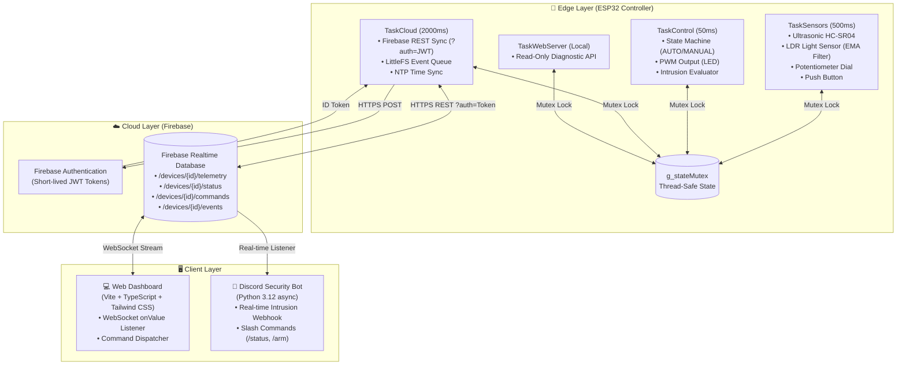

# 🏗️ System Architecture & Data Contract

This document specifies the technical design, FreeRTOS task hierarchy, communication protocols, and database schema for the Smart Garage & Security Monitor system (2026 Standards).

---

## 1. High-Level Architecture Diagram



---

## 2. FreeRTOS Task Hierarchy

| Task Name | Priority | Stack Size | Frequency | Core Responsibility |
| :--- | :---: | :---: | :---: | :--- |
| `TaskSensors` | **3 (High)** | 3 KB | 500 ms | Reads HC-SR04 ultrasonic distance, LDR analog light (with Exponential Moving Average smoothing), potentiometer dial threshold, and button debouncing. |
| `TaskControl` | **3 (High)** | 3 KB | 50 ms | Executes the lighting state machine, evaluates intrusion conditions (Armed vs Disarmed), and drives the LED PWM output. |
| `TaskCloud` | **1 (Low)** | 10 KB | 2000 ms | Manages WiFi reconnects, authenticates with Firebase Auth, patches telemetry, polls remote commands, and flushes offline LittleFS queue. |
| `TaskWebServer`| **2 (Med)** | 4 KB | Event-driven| Serves a local read-only JSON status endpoint on the LAN for diagnostics. |

---

## 3. Firebase Realtime Database Contract

All device data is organized under the root namespace `devices/{deviceId}/`:

```text
devices/{deviceId}/
  ├── commands/                         # Remote control dispatch (Web/Bot -> ESP32)
  │     ├── manual_override: boolean    # Enable/disable manual control
  │     ├── distance_threshold: number  # Override threshold in cm (5 - 200)
  │     ├── led_command: string         # "AUTO" | "ON" | "OFF"
  │     ├── armed: boolean              # Arm / Disarm security alarm
  │     ├── maintenance_mode: boolean   # Suppress alarms during maintenance
  │     └── reboot_requested_at: number # Epoch timestamp to trigger soft reboot
  │
  ├── telemetry/
  │     └── live/                       # Real-time state (ESP32 -> Web)
  │           ├── distance_cm: float    # Smoothed distance reading
  │           ├── light_level: integer  # Raw LDR light ADC value (0-4095)
  │           ├── led_state: boolean    # Actual LED state (true=ON, false=OFF)
  │           ├── pot_threshold_cm: int # Physical dial threshold
  │           ├── armed: boolean        # Security armed state
  │           ├── maintenance_mode: bool# Maintenance status
  │           ├── timestamp: integer    # Unix epoch milliseconds (UTC)
  │           └── uptime_ms: integer    # ESP32 uptime in milliseconds
  │
  ├── status/                           # Device health & diagnostics
  │     ├── online: boolean             # Connection status
  │     ├── last_seen: integer          # Unix epoch timestamp of last sync
  │     ├── firmware_version: string    # e.g., "3.0.0"
  │     ├── wifi_rssi: integer          # WiFi signal strength (dBm)
  │     ├── ip_address: string          # Local LAN IP
  │     ├── free_heap: integer          # Free RAM in KB
  │     └── reset_reason: string        # Power-on, crash, or software reset
  │
  ├── history/{fiveMinuteSlot}/          # 5-minute periodic snapshots
  │     └── ...telemetry snapshot...
  │
  └── events/{eventId}/                 # Critical security/motion events
        ├── id: string                  # Unique event UUID
        ├── event_type: string          # "INTRUSION", "OVERRIDE_ON", "REBOOT"
        ├── severity: string            # "INFO", "WARNING", "CRITICAL"
        ├── distance_cm: float          # Distance reading at event trigger
        ├── light_level: integer        # Light level at event trigger
        └── timestamp: integer          # Event timestamp in UTC
```

---

## 4. Offline Resilience Mechanism

If WiFi or Cloud connectivity drops:
1. **Local Control Uninterrupted:** `TaskSensors` and `TaskControl` continue executing on-device auto lighting without delay.
2. **Flash Queue (`LittleFS`):** Any critical security events triggered while offline are serialized as NDJSON and appended to `/pending-events.ndjson` in flash memory.
3. **Automatic Flush:** When `TaskCloud` recovers connectivity, it reads `pending-events.ndjson`, uploads all buffered events to Firebase, and deletes the local queue file only after receiving a `200 OK` response.
