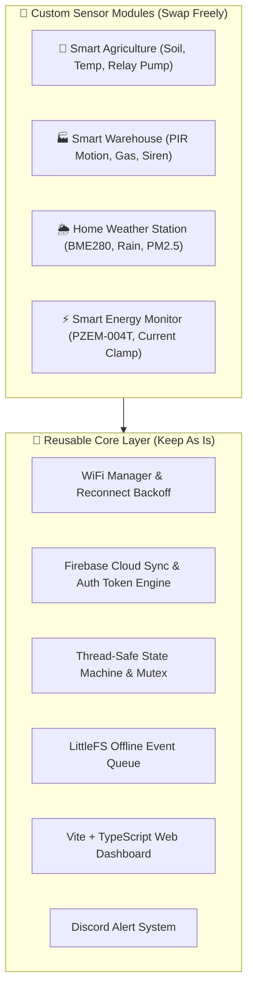

# 🚀 Extending the Foundation to Other IoT Use Cases

The architecture of this project is decoupled into **Core Infrastructure** (WiFi, FreeRTOS state engine, Firebase REST, Web Dashboard, Discord alerts) and **Application Logic** (Sensors & Actuators). 

This makes it an ideal **Starter Template** for building various commercial and industrial IoT solutions.

---

## 1. Modular Architecture Overview



---

## 2. Example Extensions

### 🌾 Scenario 1: Smart Agriculture & Irrigation (Smart Farm)
* **Replace Sensors:**
  * Swap HC-SR04 with a **Capacitive Soil Moisture Sensor** (connected to ADC1 `GPIO 34`).
  * Add a **DHT22 / SHT30 Temperature & Humidity Sensor** (connected to `GPIO 4`).
* **Replace Actuator:**
  * Swap the LED output on `GPIO 2` with a **5V Relay Module** driving a 12V water pump or solenoid valve.
* **Logic Adjustment in `TaskControl`:**
  ```cpp
  if (g_state.soilMoisture < g_state.moistureThreshold) {
      digitalWrite(RELAY_PUMP_PIN, HIGH); // Turn on water pump
  } else {
      digitalWrite(RELAY_PUMP_PIN, LOW);
  }
  ```

---

### 🏭 Scenario 2: Smart Warehouse & Asset Monitoring
* **Replace Sensors:**
  * Add a **PIR Motion Sensor (HC-SR501)** on `GPIO 13` for intrusion detection.
  * Add an **MQ-2 Gas / Smoke Sensor** on `GPIO 35` (ADC1).
  * Add a **DS18B20 Waterproof Temperature Sensor** for cold storage.
* **Replace Actuators:**
  * 12V High-Decibel Buzzer / Strobe Light.
* **Dashboard Adjustment:**
  * Modify gauge cards in `web-dashboard/src/ui_manager.ts` to display temperature and gas PPM levels.

---

### 🌦️ Scenario 3: Micro Weather & Air Quality Station
* **Replace Sensors:**
  * **BME280 / BMP280** via I2C (`SDA: GPIO 21`, `SCL: GPIO 22`) for Temperature, Humidity, and Barometric Pressure.
  * **PMS5003 / PMS7003** Optical Particle Sensor via UART2 (`RX2: GPIO 16`, `TX2: GPIO 17`) for PM2.5 and PM10 air quality.
* **Actuators:**
  * Status RGB LED / Small I2C OLED Display (SSD1306).

---

## 3. Step-by-Step Guide to Add a New Sensor

1. **Define Pins in `config.h`:**
   Add new GPIO pin constants. Ensure analog inputs use ADC1 (`GPIO 32-39`).
2. **Update `AppState` Struct in `app_state.h`:**
   Add your new sensor fields (e.g. `float soilMoisture;`).
3. **Read Sensor in `TaskSensors` (`device_tasks.cpp`):**
   Read the raw value, apply smoothing/filter, and update `g_state` inside a `lockState()` block.
4. **Publish in `TaskCloud` (`device_tasks.cpp`):**
   Add the new field to the JSON payload in `publishTelemetry()`.
5. **Display in Web Dashboard (`web-dashboard/src/ui_manager.ts`):**
   Bind the new field to a UI card or gauge.
