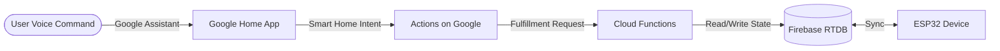

# Google Home Integration Guide for ESP32 Smart Security System

This document outlines how to integrate the ESP32 Smart Security & Garage Monitoring System with Google Home, allowing you to control lights and query sensor states via voice commands or the Google Home app.

## Overview

The integration relies on Google Cloud Functions to act as the fulfillment service between Google Home (Actions on Google) and Firebase Realtime Database, where the ESP32 reads and writes its state.



## Prerequisites

1.  **Google Cloud Project**: With the Smart Home API enabled.
2.  **Actions on Google Project**: Configured for Smart Home.
3.  **Firebase Project**: Linked to your GCP project.
4.  **Cloud Functions**: A Node.js environment to host your fulfillment webhook.
5.  **Account Linking**: OAuth2 or Google Sign-In setup to link user accounts.

## Device Traits Mapping

We map the ESP32 hardware capabilities to standard Google Home device traits.

| ESP32 Component | Google Home Trait | Actions |
| :--- | :--- | :--- |
| LED (On/Off) | `action.devices.traits.OnOff` | Turn on/off garage light |
| LED (PWM) | `action.devices.traits.Brightness` | Set brightness to X% |
| HC-SR04 Sensor | `action.devices.traits.SensorState` | What's the garage distance? |
| LDR Sensor | `action.devices.traits.SensorState` | What's the light level? |

*Note: For the sensors, you might represent the garage as a composite device or use specific traits depending on exactly how you want the queries to behave.*

## SYNC Intent Handler

The `SYNC` intent tells Google Home what devices are available and their capabilities.

```javascript
app.onSync((body) => {
  return {
    requestId: body.requestId,
    payload: {
      agentUserId: 'user123',
      devices: [{
        id: 'garage_system_1',
        type: 'action.devices.types.LIGHT',
        traits: [
          'action.devices.traits.OnOff',
          'action.devices.traits.Brightness',
          'action.devices.traits.SensorState'
        ],
        name: {
          defaultNames: ['Smart Garage'],
          name: 'Garage Light',
          nicknames: ['Garage']
        },
        willReportState: true,
        attributes: {
            // Configuration for SensorState
            sensorStatesSupported: [{
                name: 'NumericSensor',
                numericCapabilities: {
                   rawValueSupported: true
                }
            }]
        }
      }],
    },
  };
});
```

## QUERY Intent Handler

The `QUERY` intent is used when the user asks for the current state (e.g., "Is the garage light on?").

```javascript
app.onQuery(async (body) => {
  const {requestId} = body;
  
  // Read current state from Firebase RTDB
  const snapshot = await admin.database().ref('/smart_garage').once('value');
  const data = snapshot.val() || {};
  
  const sensors = data.sensors || {};
  const control = data.control || {};

  return {
    requestId: requestId,
    payload: {
      devices: {
        'garage_system_1': {
          on: control.manual_override || false, // Example logic
          brightness: 100, // Or map to a PWM value
          online: true,
          status: 'SUCCESS',
          currentSensorStateData: [{
              name: 'Distance',
              currentSensorState: sensors.distance
          }]
        },
      },
    },
  };
});
```

## EXECUTE Intent Handler

The `EXECUTE` intent handles commands to change the device state (e.g., "Turn on the garage light").

```javascript
app.onExecute(async (body) => {
  const {requestId} = body;
  const payload = { commands: [] };

  for (const command of body.inputs[0].payload.commands) {
    for (const device of command.devices) {
      for (const execution of command.execution) {
        
        let updateData = {};

        if (execution.command === 'action.devices.commands.OnOff') {
          updateData = {
              'control/manual_override': execution.params.on,
              'control/led_command': execution.params.on
          };
        } else if (execution.command === 'action.devices.commands.BrightnessAbsolute') {
          // You might need an additional field in Firebase for PWM percentage
          updateData = {
              'control/brightness': execution.params.brightness
          }
        }

        // Write commands to Firebase /smart_garage/control path
        await admin.database().ref('/smart_garage').update(updateData);

        payload.commands.push({
          ids: [device.id],
          status: 'SUCCESS',
          states: {
            on: execution.params.on,
            online: true,
          },
        });
      }
    }
  }
  return { requestId: requestId, payload: payload };
});
```

## Account Linking

Google Assistant requires account linking to associate a user's Google account with their data in your database.
- **OAuth2**: The standard way, requires setting up an authorization and token endpoint.
- **Google Sign-In (Simplified)**: For educational/personal projects, you can use Google Sign-In to streamline the process without building a full OAuth2 server, known as Google Sign-In for Assistant.

## Voice Commands

Once integrated, you can use these example voice commands:

*   "Hey Google, turn on the garage light"
*   "Hey Google, set garage brightness to 50%"
*   "Hey Google, turn off the garage"
*   "Hey Google, is the garage light on?"
*   *(If SensorState is fully implemented)* "Hey Google, what is the garage distance?"

## Deployment Steps

1.  **Create Actions on Google project**: Go to the Actions Console, create a Smart Home project.
2.  **Deploy Cloud Functions**: Deploy your Node.js webhook code to Cloud Functions.
3.  **Configure Actions Console**: Set your fulfillment URL to the deployed Cloud Function URL.
4.  **Configure Account Linking**: Set up OAuth2 or Google Sign-In details in the Actions Console.
5.  **Test with Google Home app**: Open the Google Home app, tap '+', 'Set up device', 'Works with Google', and find your test action `[test] Your Project Name`.
6.  **Submit for certification**: (Optional) Only necessary if you plan to release the integration publicly.
