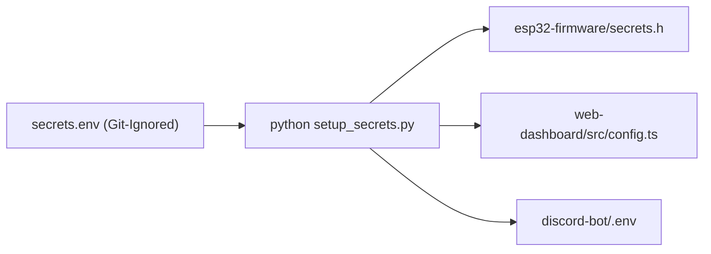

# 🔒 Security & Privacy Architecture (Zero-PII Standard)

This document describes the security model, credential management, and privacy-preserving design implemented across the Smart Garage System.

---

## 1. Secrets Isolation & Central Vault

All sensitive credentials (API keys, Wi-Fi passwords, database URLs, auth tokens) are isolated in a single file: `secrets.env`.

### Security Guarantees:
- `secrets.env`, `secrets.h`, and `discord-bot/.env` are strictly excluded from version control via `.gitignore`.
- Only sanitized templates (`secrets.example.env`, `secrets.example.h`, `discord-bot/.env.example`) are committed to GitHub.

---

## 2. Token-Based Authentication Flow

Unlike legacy IoT architectures that embed a permanent, long-lived master database secret in the firmware, this system uses **Ephemeral JSON Web Tokens (JWTs)**:

1. **Initial Sign-In:** At startup, the ESP32 issues an HTTPS POST request to Google Identity Toolkit with its dedicated service email and password.
2. **Short-Lived Token:** Google returns an `idToken` valid for 1 hour (3600 seconds).
3. **Authenticated REST Queries:** All telemetry updates append `?auth=<idToken>` to the request URL.
4. **Automatic Renewal:** The firmware transparently refreshes the token 1 minute before expiration (`tokenExpiresAt_ - millis() > 60000`).

---

## 3. Zero-PII Logging (Privacy by Design)

To ensure privacy during live demonstrations, screen sharing, and open-source contributions:
- **Masked Credentials:** Firmware serial monitor outputs mask user identifiers (e.g. `u***@example.com`) and never print plaintext passwords or raw JWT signatures.
- **Diagnostic Code Only:** Serial outputs display high-level state transitions (e.g. `[FIREBASE] Device authentication succeeded`, `[WIFI] Connected: 192.168.1.100`) rather than sensitive payloads.

---

## 4. Threat Model & Mitigations

| Threat Vector | Potential Impact | Mitigation in Place |
| :--- | :--- | :--- |
| **Public Database Scraping** | Unauthorized reading/writing of sensor states | Database Security Rules mandate `auth != null`. Unauthenticated requests receive HTTP 401 Unauthorized. |
| **Replay Attack / Stolen Firmware Binary** | Extraction of master cloud credentials | ESP32 stores only a low-privilege service account user, never a root Firebase Admin key. |
| **Network Interception (Man-In-The-Middle)** | Eavesdropping on telemetry | All cloud communications use TLS 1.2 / 1.3 HTTPS encryption (`WiFiClientSecure`). |
| **Denial of Service (Cloud Outage)** | Garage light fails to turn on | Local FreeRTOS tasks control actuators independently of cloud connectivity. |
