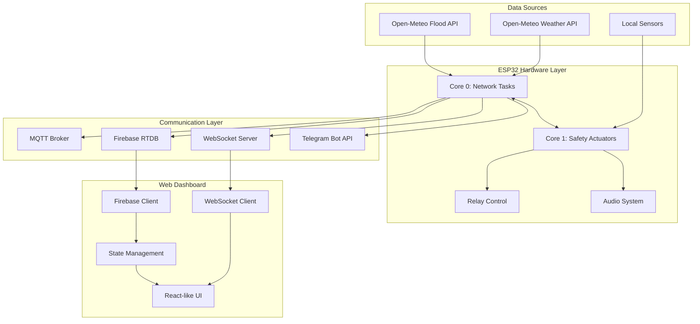

# System Architecture

## Overview

The Smart Building Command Center is a comprehensive IoT disaster early warning system built on a three-tier architecture:

1. **Data Acquisition Layer** - ESP32 microcontrollers with sensor arrays
2. **Communication Layer** - MQTT, WebSocket, Firebase Realtime Database
3. **Presentation Layer** - Web Dashboard with real-time visualization

## Architecture Diagram



## Data Flow

### 1. Weather Data Acquisition

```
Open-Meteo API → HTTPS Request → ESP32 Core 0 → Data Parsing → Hazard Assessment
```

**Process:**
1. ESP32 polls Open-Meteo Forecast API every 60 seconds
2. Fetches: temperature, humidity, UV index, wind speed, wind gusts, precipitation, weather code
3. Simultaneously fetches river discharge from Flood API
4. Data is parsed and validated
5. Sent to 6-Hazard Assessment Engine

### 2. Hazard Assessment Engine

The 6-hazard assessment algorithm evaluates conditions in parallel:

```typescript
function assessHazards(data: WeatherData): HazardLevel {
    const uvRisk = data.uv_index >= 11.0 ? 'CRITICAL' : 
                   data.uv_index >= 8.0 ? 'WARNING' : 'NORMAL';
    
    const heatRisk = data.apparent_temperature >= 41.0 ? 'CRITICAL' :
                     data.apparent_temperature >= 37.0 ? 'WARNING' : 'NORMAL';
    
    const stormRisk = data.weather_code === 96 || data.weather_code === 99 ? 'CRITICAL' :
                      data.weather_code === 95 ? 'WARNING' : 'NORMAL';
    
    const windRisk = data.wind_gusts >= 89.0 ? 'CRITICAL' :
                     data.wind_gusts >= 50.0 ? 'WARNING' : 'NORMAL';
    
    const rainRisk = data.precipitation >= 35.0 ? 'CRITICAL' :
                     data.precipitation >= 10.0 ? 'WARNING' : 'NORMAL';
    
    const floodRisk = data.river_discharge >= 500.0 ? 'WARNING' : 'NORMAL';
    
    // Return highest risk level
    return Math.max(uvRisk, heatRisk, stormRisk, windRisk, rainRisk, floodRisk);
}
```

### 3. Actuator Response

Based on hazard level, the system triggers automated responses:

| Hazard Level | Strobe (GPIO 2) | Doors (GPIO 4) | Siren (GPIO 27) | Telegram Alert |
|--------------|-----------------|----------------|-----------------|----------------|
| NORMAL       | OFF             | LOCKED         | MUTED           | No             |
| WARNING      | ON (Slow blink) | LOCKED         | ALERT MODE      | Yes            |
| CRITICAL     | ON (Fast blink) | UNLOCKED       | FULL SIREN      | Yes            |

### 4. Data Distribution

**Multiple Channels:**

1. **MQTT (HiveMQ)**
   - Topic: `smart_building/{device_id}/telemetry`
   - QoS: 1 (At least once)
   - Retained: false
   - Port: 1883

2. **Firebase Realtime Database**
   - Path: `devices/{device_id}/telemetry/live`
   - Path: `devices/{device_id}/status`
   - Path: `devices/{device_id}/relays`
   - Real-time sync with web dashboard

3. **WebSocket**
   - Protocol: Custom JSON-based (version 1.0.0)
   - Message types: telemetry, command, ack, error, config, heartbeat, status
   - Bi-directional communication

4. **Telegram Bot**
   - API: `https://api.telegram.org/bot{token}/sendMessage`
   - Parse mode: HTML
   - Thai language alerts with emoji indicators

## Communication Protocols

### WebSocket Protocol

**Message Structure:**
```json
{
  "version": "1.0.0",
  "type": "telemetry",
  "timestamp": 1234567890,
  "id": "device-123-timestamp-random",
  "payload": {
    "device_id": "smart_building_001",
    "temperature": 35.5,
    "uv_index": 9.2,
    "wind_gusts": 45.0,
    "precipitation": 5.0,
    "weather_code": 1,
    "river_discharge": 120.0,
    "relay_states": {
      "strobe": false,
      "door": true,
      "siren": false
    }
  }
}
```

**Message Types:**
- `telemetry` - Live sensor data from ESP32
- `command` - Control commands sent to ESP32
- `ack` - Acknowledgment for received commands
- `error` - Error messages
- `config` - Configuration updates
- `heartbeat` - Ping/Pong for connection health
- `status` - Device status updates

### MQTT Protocol

**Topic Structure:**
```
smart_building/{device_id}/telemetry
smart_building/{device_id}/status
smart_building/{device_id}/commands
smart_building/{device_id}/alerts
```

**Payload Format:**
```json
{
  "timestamp": 1234567890,
  "device_id": "smart_building_001",
  "province": "กรุงเทพมหานคร",
  "severity": "WARNING",
  "metrics": {
    "uv_index": 9.2,
    "apparent_temperature": 38.5,
    "wind_gusts": 55.0,
    "precipitation": 12.0,
    "weather_code": 95,
    "river_discharge": 320.0
  }
}
```

### Firebase Realtime Database

**Data Structure:**
```
devices/
  {device_id}/
    telemetry/
      live/
        temperature: 35.5
        uv_index: 9.2
        wind_gusts: 45.0
        ...
      historical/
        {timestamp}/
          ...
    status/
      online: true
      uptime_sec: 3600
      firmware_version: "4.0.0"
    relays/
      strobe: false
      door: true
      siren: false
    alerts/
      {alert_id}/
        severity: "CRITICAL"
        message: "..."
        timestamp: 1234567890
```

## Hardware Architecture

### ESP32 Dual-Core Assignment

**Core 0 (Network & Cloud Tasks):**
- Open-Meteo HTTPS polling (60s interval)
- MQTT publish/subscribe (HiveMQ broker)
- Telegram Bot HTTPS requests
- Firebase Realtime Database sync
- Async WebServer & WebSocket handling

**Core 1 (Safety & Actuators):**
- 6-Hazard Alert Engine (100ms cycle)
- Relay sequencing (20ms response time)
- Audio siren & DFPlayer Mini control
- Button debounce (GPIO 15 silence/test)
- LED status indicators

### GPIO Pin Mapping

| GPIO | Function          | Direction | Voltage | Description                          |
|------|-------------------|-----------|---------|--------------------------------------|
| 2    | Strobe Relay      | Output    | 3.3V→5V | Emergency strobe alarm               |
| 4    | Door Relay        | Output    | 3.3V→5V | Emergency door lock release         |
| 12   | LED Green         | Output    | 3.3V    | Normal status indicator              |
| 13   | LED Yellow        | Output    | 3.3V    | Warning status indicator             |
| 14   | LED Red           | Output    | 3.3V    | Critical status indicator            |
| 15   | Silence Button    | Input     | 3.3V    | Manual silence/test (PULLUP)         |
| 16   | DFPlayer RX       | Input     | 3.3V    | UART2 receive (via 1kΩ resistor)     |
| 17   | DFPlayer TX       | Output    | 3.3V    | UART2 transmit (via 1kΩ resistor)    |
| 27   | PWM Siren         | Output    | 3.3V    | Piezo buzzer/speaker                 |
| 34   | Light Sensor      | Input     | 0-3.3V  | ADC1 - LDR for building light level |
| 35   | Potentiometer     | Input     | 0-3.3V  | ADC1 - Sensitivity adjustment        |

## Software Architecture

### Web Dashboard Structure

```
web-dashboard/
├── src/
│   ├── main.ts              # Application entry point
│   ├── config.ts            # Firebase & system configuration
│   ├── ui_manager.ts        # UI state management & rendering
│   ├── device_controller.ts # Device control functions
│   ├── firebase_client.ts   # Firebase Realtime Database client
│   ├── websocket_client.ts  # WebSocket connection manager
│   ├── websocket_types.ts   # WebSocket protocol definitions
│   ├── firebase_types.ts    # Firebase data type definitions
│   ├── store_types.ts       # State management types
│   ├── translations.ts      # Thai/English translations
│   ├── style.css            # Global styles
│   ├── ui.css               # UI component styles
│   ├── input.css            # Tailwind CSS input
│   └── index.html           # Main HTML template
├── package.json
├── vite.config.ts
├── tsconfig.json
└── tailwind.config.js
```

### Module Responsibilities

**main.ts**
- Application initialization
- Event listener setup
- Global function exposure (injectScenario)
- Polling interval management

**config.ts**
- Firebase configuration
- Connection parameters
- Retry/backoff settings
- Validation rules
- Performance monitoring settings

**ui_manager.ts**
- Province database (77 Thai provinces)
- UI element references
- Dashboard update logic
- Toast notifications
- Text-to-speech (Thai)
- History log management
- WMO code interpretation

**device_controller.ts**
- Open-Meteo API integration
- Hazard assessment logic
- Relay control functions
- Telegram alert dispatch
- CSV export functionality

**firebase_client.ts**
- Firebase app initialization
- Realtime database listeners
- Connection state management
- Offline mode handling

**websocket_client.ts**
- WebSocket connection management
- Auto-reconnection with exponential backoff
- Heartbeat/ping-pong mechanism
- Message queue for offline buffering
- Rate limiting
- Connection pooling

## State Management

### Global State

The dashboard uses a centralized state management approach:

```typescript
interface DashboardState {
  currentProvince: string;
  weatherData: WeatherData;
  severity: 'NORMAL' | 'WARNING' | 'CRITICAL';
  relayStates: {
    strobe: boolean;
    door: boolean;
    siren: boolean;
  };
  connectionStatus: {
    firebase: boolean;
    websocket: boolean;
    mqtt: boolean;
  };
  historyLogs: HistoryEntry[];
  uptime: number;
  lastUpdate: Date;
}
```

### Event Flow

1. **Data Update Event**
   ```
   Open-Meteo API → fetchOpenMeteoWeather() → 
   updateDashboardUI() → DOM Updates + History Log
   ```

2. **Control Command Event**
   ```
   User Click → toggleStrobe() → Firebase/MQTT Publish → 
   ESP32 Receives → Actuator Response → Ack → UI Update
   ```

3. **Alert Trigger Event**
   ```
   Hazard Detected → Severity Assessment → 
   Telegram Alert + Siren + Relay Activation → 
   UI Alert Banner + Voice Announcement
   ```

## Performance Considerations

### Data Debouncing

To prevent UI thrashing from high-frequency updates:

```typescript
DEBOUNCE_CONFIG = {
  telemetryDebounceMs: 500,    // Weather data updates
  statusDebounceMs: 1000,      // Status updates
  relayDebounceMs: 200,       // Relay state changes
  maxWaitMs: 2000             // Maximum debounce delay
}
```

### Connection Management

**Firebase:**
- Connection timeout: 10 seconds
- Heartbeat interval: 30 seconds
- Max reconnection attempts: Infinite (-1)
- Initial reconnect delay: 1 second
- Max reconnect delay: 30 seconds
- Exponential backoff multiplier: 2x

**WebSocket:**
- Auto-reconnect enabled
- Reconnect interval: 1 second (exponential backoff)
- Max reconnect attempts: 10
- Heartbeat interval: 30 seconds
- Connection timeout: 10 seconds
- Message buffer: 100 messages max

### Rate Limiting

**Telegram API:**
- Max 10 messages per second per message type
- 1-second sliding window
- Queue for offline buffering

**WebSocket:**
- Max 10 messages per second per type
- 1-second sliding window
- Message buffering during disconnection

## Security Considerations

### Firebase Security Rules

```
{
  "rules": {
    "devices": {
      "$device_id": {
        ".read": "auth != null",
        ".write": "auth != null && auth.token.admin == true",
        "telemetry": {
          ".write": "auth != null"
        },
        "relays": {
          ".write": "auth != null && auth.token.admin == true"
        }
      }
    }
  }
}
```

### WebSocket Security

- Token-based authentication
- Secure WebSocket (WSS) enforced in production
- Device ID validation
- Message version validation
- Rate limiting to prevent DoS

### Environment Variables

Sensitive configuration should use environment variables:

```bash
VITE_FIREBASE_API_KEY=your_api_key
VITE_FIREBASE_PROJECT_ID=your_project_id
VITE_FIREBASE_DATABASE_URL=your_database_url
VITE_FIREBASE_APP_ID=your_app_id
VITE_DEVICE_ID=smart_building_001
```

## Scalability

### Multi-Device Support

The system supports multiple ESP32 devices through:

1. **Device ID-based routing** in Firebase paths
2. **WebSocket connection pooling** for multiple simultaneous connections
3. **MQTT topic separation** per device
4. **Province-based data isolation**

### Geographic Coverage

- 77 Thai provinces with precise coordinates
- Lat/Lon resolution: 4 decimal places (~11m accuracy)
- Regional weather data fetching
- Province-specific hazard thresholds (configurable)

## Deployment Architecture

### Development Mode
```
Vite Dev Server (http://localhost:5173)
  ├── Hot Module Replacement (HMR)
  ├── TypeScript compilation on-the-fly
  ├── Tailwind CSS JIT compilation
  └── Firebase/WebSocket connections to staging
```

### Production Mode
```
Built Static Files (dist/)
  ├── Minified JavaScript
  ├── Optimized CSS
  ├── PWA Service Worker
  └── Deployed to Firebase Hosting / GitHub Pages
```

### PWA Features

- Offline caching of dashboard
- Background sync for alerts
- Push notification support
- Installable as desktop app

## Monitoring & Debugging

### Logging Configuration

```typescript
LOGGING_CONFIG = {
  enableLogging: true,
  logLevel: 'info',
  logReads: true,
  logWrites: true,
  logConnectionEvents: true,
  logValidationErrors: true,
  maxLogEntries: 100
}
```

### Performance Metrics

- Operation latency tracking
- Data transfer size monitoring
- Slow operation alerts (>1000ms threshold)
- Connection health monitoring

## Data Persistence

### Browser Storage

- **localStorage**: Language preference (Thai/English)
- **sessionStorage**: Temporary UI state
- **IndexedDB**: Historical telemetry cache (planned)

### Firebase Persistence

- **Offline persistence**: Enabled (10MB cache)
- **Cache TTL**: 5 minutes
- **Automatic sync**: When connection restored

## Error Handling

### Recovery Strategies

1. **Network Failure**: Exponential backoff reconnection
2. **Data Validation**: Sanitize invalid data, log errors
3. **API Failure**: Use cached data, show warning toast
4. **Firebase Unavailable**: Run in standalone simulation mode
5. **WebSocket Disconnect**: Buffer messages, auto-reconnect

### Fallback Modes

**Standalone Mode:**
- Uses Open-Meteo API directly
- No Firebase required
- Simulation scenarios available
- Manual relay control

**Offline Mode:**
- Cached weather data
- Last known relay states
- Manual override available
- Warning banners displayed
